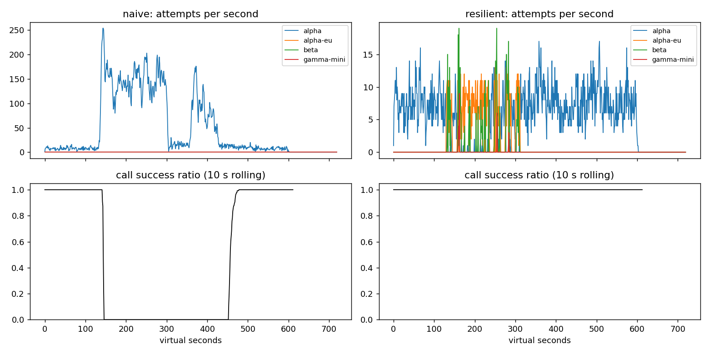

# Lab 25B — Báo cáo thực nghiệm Game Day & Postmortem

**Họ tên:** Nguyễn Văn Đại  
**Mã sinh viên:** 2A202602477  
**Môi trường:** Windows/PowerShell; các script Python của dự án  
**Seed:** 25 (các thí nghiệm và kết quả báo cáo)  
**Commit:** _Điền kết quả `git rev-parse --short HEAD` trước khi nộp_  
**Điểm tự động công khai:** **84/88**; Part E: **8/12** do **4 điểm hidden chưa được đánh giá** (`slo_hidden.pass = null`).  
**Nguồn số liệu:** `reports/gameday/*.json`, `reports/gameday/*_timeseries.csv`, `reports/workflows.json`, `reports/slo.json`, `reports/cache/*.json`, `reports/scoreboard.json`. Các thí nghiệm thay cấu hình được chạy tách biệt với cùng seed 25, không thay đổi tập test, simulator hay file chấm điểm.

## 1. Kết quả Game Day (naive so với resilient client)

| Băng | Client | Availability | p95 (s) | Amplification | Retry ratio | Cost / good turn | Recovery (s) | PASS? |
|---|---|---:|---:|---:|---:|---:|---:|:---:|
| G1 | naive | 0.7194 | 7.157 | 7.738 | 6.738 | 2.163 | 4 | FAIL |
| G1 | yours | 1.0000 | 4.735 | 1.061 | 0.001 | 2.095 | 0 | PASS |
| G2 | naive | 0.4560 | 15.034 | 9.904 | 8.904 | 4.627 | 155 | FAIL |
| G2 | yours | 1.0000 | 12.029 | 1.061 | 0.007 | 2.151 | 0 | PASS |
| G3 | naive | 1.0000 | 4.768 | 1.164 | 0.164 | 2.328 | 0 | FAIL |
| G3 | yours | 1.0000 | 4.668 | 1.059 | 0.030 | 2.143 | 0 | PASS |
| G4 | naive | 1.0000 | 13.764 | 1.004 | 0.004 | 2.008 | 0 | FAIL |
| G4 | yours | 1.0000 | 5.626 | 1.014 | 0.002 | 2.072 | 0 | PASS |
| G5 | naive | 0.3699 | 5.359 | 17.030 | 16.030 | 2.124 | N/A | FAIL |
| G5 | yours | 0.8179 | 5.477 | 1.003 | 0.002 | 2.504 | N/A | PASS |
| G6 | naive | 0.5170 | 4.836 | 12.344 | 11.344 | 2.009 | 0 | FAIL |
| G6 | yours | 1.0000 | 6.025 | 1.056 | 0.019 | 2.188 | 0 | PASS |

Sáu băng gồm G1 (rate-limit spike), G2 (overload storm), G3 (brownout), G4 (slow region), G5 (bad deploy + quota), G6 (provider outage). Client cải tiến đạt **6/6 băng PASS**. Riêng G2, availability tăng từ **45,60% lên 100%**, amplification giảm từ **9,904 xuống 1,061** (giảm ~89,3%), retry ratio giảm từ **8,904 xuống 0,007**, recovery giảm từ **155 s xuống 0 s**. G5 dù cải thiện mạnh từ 36,99% lên 81,79% vẫn có request thất bại; PASS là đạt điều kiện của kịch bản, **không đồng nghĩa 100% availability**. `N/A` ở recovery là tình huống không có mốc phục hồi xác định trong dữ liệu mô phỏng; không được hiểu là 0 giây.

## 2. Cấu hình client và cơ sở lựa chọn

| Tham số | Giá trị | Lý do gắn với kết quả |
|---|---:|---|
| `attempt_timeout_s` | 8.0 s | Tránh giữ attempt tới sát deadline 30 s; G6 với 8 s availability 1.0000, với 30 s chỉ còn 0.9488 (thí nghiệm §3). |
| `max_attempts_per_provider` | 2 | Giới hạn retry cùng provider trước failover; G2 amplification 1.061, thấp hơn nhiều naive 9.904. |
| `min_time_left_s` | 1.0 s | Không khởi chạy lượt gọi không còn thời gian hữu ích trước deadline. |
| `backoff_base_s / backoff_cap_s` | 0.25 / 4.0 s | Full jitter trải retry thay vì đồng loạt; G1 có 0 vi phạm `retry_after` và amplification 1.061. |
| `retry_budget_ratio` | 0.10 | Khi breaker cấu hình sai trên G2, giữ budget cho retry ratio 0.059 thay vì 0.378 khi tắt (§3). |
| `retry_budget_min_per_s / max_tokens` | 0.5 / 20 | Cho phép một lượng thử lại hạn chế khi tải thấp, hạn chế retry storm khi tải cao. |
| `breaker.window_size / min_calls` | 20 / 10 | Đủ mẫu để đánh giá sức khỏe và mở sớm; G2 100% hoàn tất trong cấu hình gốc. |
| `breaker.failure_rate_threshold` | 0.50 | Mở breaker khi lỗi thường xuyên, tránh dồn tải vào provider đang suy giảm. |
| `breaker.slow_call_s / slow_rate_threshold` | 5.0 s / 0.60 | Phát hiện brownout qua slow-call, không chỉ HTTP error; G4 p95 từ naive 13.764 s xuống 5.626 s. |
| `breaker.open_duration_s` | 10.0 s | Cho provider nghỉ ngắn, thăm dò định kỳ thay vì ngắt vĩnh viễn. |
| `breaker.half_open_max_probes / half_open_successes` | 2 / 2 | Giới hạn request thăm dò, chỉ đóng lại khi có đủ kết quả tốt. |
| `quota_cooldown_s` | 300 s | Không tiếp tục đập quota vừa cạn ở G5; retry ratio của client cải tiến chỉ 0.002. |

**Quyết định của `on_error`** (mức hành vi):

```text
Provider result
├── Success → breaker.on_success → trả kết quả
└── Error → classify
    ├── 400 client_error → release permit → GiveUp, không retry/failover
    ├── 429 quota_exhausted → release → cooldown 300s → failover
    ├── 429 rate_limited → release → tôn trọng retry_after → failover
    └── 5xx / overloaded / timeout → breaker.on_failure
        ├── Còn lượt thử, còn budget, còn deadline → FullJitterBackoff → retry
        └── Không đủ điều kiện → failover provider hợp lệ → GiveUp nếu hết
```

`ladder(task)` chỉ định tuyến tool call tới provider có `supports_tools=True`. G6 có `incompatible_routes = 0` ở cấu hình chính; bỏ lọc này gây 253 lần định tuyến không tương thích (§3).

## 3. Ba thí nghiệm đối chứng

Mỗi thí nghiệm sử dụng **seed 25** và bản cấu hình tạm (chỉ thay tham số được nêu). Các giá trị không nêu giữ nguyên `configs/gameday.yaml`. Đã chạy bằng công cụ mô phỏng sẵn trong dự án; không sửa simulator hay dữ liệu kiểm thử.

### 3.1. Retry budget là phòng tuyến cuối khi breaker hoạt động sai

Thiết lập `breaker.min_calls = 1000000000`, `max_attempts_per_provider = 5`; so sánh (a) budget hiện tại (`ratio = 0.1`, `max_tokens = 20`, `min_per_s = 0.5`) và (b) gần như tắt budget (`ratio = 100`, `max_tokens = 1e9`, `min_per_s = 1e6`).

| Băng | Budget | Availability | p95 (s) | Amplification | Retry ratio | Recovery (s) | PASS? |
|---|---|---:|---:|---:|---:|---:|:---:|
| G2 | Bật | 0.9987 | 19.242 | 1.384 | 0.059 | 0 | PASS |
| G3 | Bật | 1.0000 | 4.565 | 1.136 | 0.068 | 0 | PASS |
| G2 | Tắt | 0.9754 | 21.482 | 1.580 | 0.378 | 24 | PASS |
| G3 | Tắt | 1.0000 | 4.661 | 1.162 | 0.158 | 0 | FAIL |

Khi breaker không mở được, G2 tắt budget làm retry ratio tăng **0.059 → 0.378** (~6,4 lần), amplification **1.384 → 1.580**, p95 **19.242 → 21.482 s**, availability giảm **99,87% → 97,54%**, recovery tăng **0 → 24 s**. Với G3, retry ratio tăng **0.068 → 0.158** (~2,3 lần), làm kịch bản không còn PASS. Breaker giới hạn tác động **theo provider**, còn retry budget giới hạn khả năng bùng nổ số lần thử lại **trên toàn client** khi cấu hình breaker sai hoặc chưa đủ số mẫu. Vì vậy phải triển khai **cả hai**. Khi breaker chuẩn, tỷ lệ retry trên G2/G3 chỉ **0.007/0.030**, nhưng budget vẫn là cơ chế dự phòng độc lập.

### 3.2. Timeout 30 giây so với 8 giây

| Băng | Timeout | Availability | p95 (s) | Cost / turn | PASS? |
|---|---:|---:|---:|---:|:---:|
| G4 | 8s | 1.0000 | 5.626 | 2.072 | PASS |
| G4 | 30s | 1.0000 | 5.608 | 2.082 | PASS |
| G6 | 8s | 1.0000 | 6.025 | 2.188 | PASS |
| G6 | 30s | 0.9488 | 5.314 | 2.234 | FAIL |

Ở G4, hai timeout có p95 gần nhau (**5.626 s** và **5.608 s**) và đều PASS; không có bằng chứng rằng tăng timeout luôn làm p95 tăng. Ngược lại, trong G6, nâng timeout 8 → 30 s khiến availability giảm **100% → 94,88%**, cost / good turn tăng **2.188 → 2.234** và kịch bản FAIL. p95 G6 của các lượt *thành công* lại giảm từ 6.025 xuống 5.314 s: cần tránh hiểu nhầm đây là cải thiện tổng thể do các lượt timeout thất bại không đóng góp cùng cách vào phân vị thành công. Timeout nên chọn từ p95/p99 theo provider, thời hạn người dùng và thời gian dự phòng cho failover, không đơn thuần lấy bằng deadline 30 s.

### 3.3. Bỏ lọc khả năng tool calling khỏi fallback ladder

Trên G6, cấu hình đúng có `incompatible_routes = 0`, availability **1.0000**, cost/turn **2.188** (PASS). Khi thử cho `ladder()` trả về toàn bộ provider mà không kiểm tra `supports_tools`, kết quả là **253 incompatible routes**, availability **0.8939**, cost/turn **2.269** (FAIL). Với góc nhìn sản phẩm, chatbot có thể chuyển yêu cầu **cần gọi công cụ** sang một model không hỗ trợ tool calling; model đó không thể thực hiện bước nghiệp vụ mà người dùng yêu cầu. Vì vậy fallback phải tương thích năng lực, không chỉ ưu tiên model rẻ/nhanh.

## 4. Workflow hoàn tiền — exactly-once

Chuỗi 5 bước: `classify_request → lookup_order → issue_refund → send_email → write_summary`.

| Executor | Completion | Worker crashes | Duplicate refunds | Duplicate emails | Lost refunds | Overpaid (cents) | Wasted LLM/crash |
|---|---:|---:|---:|---:|---:|---:|---:|
| naive | 1.000 | 81 | 128 | 81 | 0 | 1574200 | 1.123 |
| yours | 1.000 | 66 | 0 | 0 | 0 | 0 | 0.303 |

Trong **500 session**, executor cải tiến hoàn thành **500/500**, **0 refund trùng, 0 email trùng, 0 refund mất**, **0 tiền trả dư**, chỉ **20 LLM calls lãng phí** trên **66 crash** (0.303/crash). Naive có **128** refund trùng và **81** email trùng, trả dư **1,574,200 cents**, lãng phí **91 LLM calls** trên 81 crash (1.123/crash).

**Vì sao cần idempotency key *và* checkpoint?** Một idempotency key ổn định theo `(session, step)` giúp payment/email xử lý lặp lại theo cách không gây side effect trùng sau timeout hoặc worker crash; nhưng key không giúp worker biết những bước LLM/tra cứu nào đã hoàn tất. Checkpoint lưu kết quả step đã thành công giúp resume và không tính toán lại; tuy nhiên chỉ checkpoint thì không giải quyết được khoảng thời gian side effect đã xảy ra nhưng checkpoint chưa kịp được ghi. Nếu ghi checkpoint **trước** khi gọi payment, crash sẽ khiến resume nhầm rằng đã refund trong khi tiền chưa chuyển, từ đó gây **lost refund**. Thiết kế đúng: stable key cho side effect, thực thi idempotent, sau đó lưu checkpoint và resume an toàn; đối với hệ thống thực tế cần store durable và reconciliation cho các kết quả chưa rõ.

## 5. Burn-rate alerting và error budget

SLO availability **99,5% / 30 ngày**. Phương pháp dùng 3 quy tắc hai cửa sổ: page 14.4× (60/5 phút), page 6× (360/30 phút), ticket 1× (4320/360 phút); tính tổng cửa sổ bằng prefix sum.

| Sự cố | Mong đợi | Naive alerter | Burn-rate alerter | Trễ phát hiện |
|---|---|---|---|---:|
| checkout_bug | page | page +1m | page +27m | 27 phút |
| provider_outage | page | page +0m | page +4m | 4 phút |
| deploy_blip | none | false page | not detected | — |
| slow_leak | ticket | not detected | ticket +1337m | 1337 phút |
| degraded_evening | page | page +214m | page +291m | 291 phút |
| night_spike | none | false page | not detected | — |
| small_bump | none | false page | not detected | — |

Naive phát **7 page, 0 ticket, 3 false page**; burn-rate phát **3 page, 1 ticket, 0 false page**. Dữ liệu public PASS; hidden test chưa được giảng viên cung cấp hoặc chạy (`slo_hidden.pass = null`).

- **Tổng requests:** 25,901,755.
- **Lỗi cho phép:** 129,508.8 (= 0.005 × requests; đã làm tròn theo rubric).
- **Lỗi thực tế:** 55,618 → availability **99.7853%**.
- **Budget tiêu thụ:** 55,618 / 129,508.775 = **42,95%**.
- **Budget còn lại:** **57,05%** → `freeze_releases = False`, **chưa phải đóng băng release** theo quy tắc của bài.

`small_bump` kéo dài 20 phút với tỷ lệ lỗi 12% nhưng không đủ **hai cửa sổ đồng thời vượt ngưỡng page**; tạo page chỉ theo 5 phút sẽ làm phiền on-call và tạo false alarm. Burn-rate nhiều cửa sổ xác minh sự cố vừa đủ nghiêm trọng **và vẫn đang tiếp diễn**; slow leak được chuyển thành ticket thay vì đánh thức on-call.

## 6. Postmortem G2 — Overload storm (blameless)

### 6.1. Executive summary

Trong kịch bản G2, provider `alpha` **mất 75% năng lực GPU từ t=120 s**, rồi khôi phục ở **t=300 s**. Naive client bị retry storm, chỉ có **1,077/2,362 user turns** thành công (availability **45,60%**), amplification **9.904**, và cần thêm **155 s** để hệ thống hồi phục. Với cấu hình resilient, **2,362/2,362** lượt thành công, amplification **1.061** và thời gian hồi phục sau restoration theo metric là **0 s**. Đây là vấn đề phòng thủ hệ thống và thiết kế retry liên tầng, không quy lỗi cho cá nhân.

### 6.2. Ảnh hưởng định lượng

- **Lượt thành công:** 1,077; **lượt thất bại:** 2,362 − 1,077 = **1,285** (54,40% số lượt).
- **Độ trễ:** p95 naive **15.034 s** (so với resilient **12.029 s**); **chi phí trên mỗi lượt thành công:** 4.627 so với 2.151.
- **Phạm vi theo thời gian:** suy giảm bắt đầu ở **t≈130 s**, provider hồi phục t=300 s, nhưng thành công của naive chỉ ổn định lại quanh **t≈455–470 s**, phù hợp `recovery_s = 155`.
- **Ảnh hưởng tới error budget tháng (giả thiết rõ ràng):** nếu tháng 30 ngày có tải đều **4 user turns/s** như `configs/gameday.yaml`, tổng xấp xỉ **10,368,000 turns**, budget lỗi tháng ở SLO 99,5% là **51,840 turns**. Riêng **1,285 turns** lỗi G2 dùng khoảng **2,48% budget tháng**. Đây là phép ngoại suy phục vụ postmortem; không phải budget tính từ public SLI 30 ngày ở mục 5.

### 6.3. Timeline từ CSV — giây ảo

Các chỉ số bên dưới tính trên **10 giây quanh mốc** (t−4 đến t+5, có cắt ở biên), attempts/s là trung bình `attempts_alpha`, success ratio = tổng `calls_ok` / tổng `calls_done`. Dữ liệu gốc: `reports/gameday/naive_G2_overload_storm_timeseries.csv`.

| Thời điểm (s) | Quan sát | Attempts alpha / s (10s) | Call success ratio (10s) |
|---:|---|---:|---:|
| 100 | Trước sự cố; lưu lượng ổn định | 7.2 | 100% |
| 120 | Mất 75% năng lực GPU bắt đầu; chưa kịp tích lũy backlog | 6.5 | 100% |
| 140 | Retry tăng đột biến | 186.8 | 21.4% |
| 160 | Request lỗi hàng loạt | 160.0 | 0% |
| 230 | Sự cố kéo dài; hệ thống mắc trong retry storm | 162.7 | 0% |
| 300 | Provider khôi phục năng lực, backlog chưa rút | 91.0 | 0% |
| 360 | Đợt retry tồn đọng tiếp tục xuất hiện | 62.1 | 0% |
| 420 | Dù GPU phục hồi, xác suất hoàn thành vẫn bằng 0 ở cửa sổ đo | 54.0 | 0% |
| 455 | Hồi phục một phần | 13.5 | 68.4% |
| 480 | Trở lại vận hành ổn định | 9.4 | 100% |



### 6.4. Trigger, nguyên nhân gốc và lý do không tự hồi phục ở t=300

**Trigger:** alpha mất 75% tài nguyên GPU trong khoảng **t=120–300 s**, giảm đáng kể năng lực xử lý. **Root cause:** các tầng app/gateway/SDK có chính sách retry không được phối hợp; thiếu retry budget, jitter và circuit breaker làm mỗi logical call có thể sinh ra nhiều request mới. Số attempts tăng lên trung bình **186.8/s tại t=140** trong khi trước sự cố khoảng **7.2/s tại t=100**; toàn băng có amplification **9.904**.

Ngay cả khi GPU phục hồi t=300, **request backlog và retry từ client đã quá hạn vẫn cạnh tranh với request mới**. Hàng đợi càng cao thì latency/timeout càng lớn; timeout lại kích hoạt retry, khiến tải tiếp tục cao hơn năng lực phục vụ. Vòng lặp tự duy trì này là **metastable failure**: khôi phục tài nguyên gốc không tự động phá được backlog + retry feedback loop; mô phỏng ghi nhận thêm **155 s** để hồi phục.

### 6.5. Yếu tố hỗ trợ và hạn chế

- **Giúp ổn định:** circuit breaker mở theo lỗi/slow call, failover sang `alpha-eu`/`beta` hợp lệ, hạn chế retry bằng budget, backoff full jitter và deadline-aware routing. G2 resilient đạt **100% availability**, amplification **1.061**.
- **Làm tệ hơn:** retry ba tầng không ngân sách và không jitter, retry vào provider vừa quá tải, không cô lập backlog, client tiếp tục gửi request sau khi người dùng đã rời đi.
- **Giới hạn của kết quả:** đây là mô phỏng seed 25; chưa khẳng định cùng định lượng trên mọi workload, provider hoặc dữ liệu ẩn.

### 6.6. Action items (blameless, có owner và phép đo)

| # | Hành động | Nhóm | Owner (vai trò) | Tiêu chí hoàn thành / xác minh |
|---:|---|---|---|---|
| 1 | Thống nhất **một tầng điều phối retry**; full jitter và retry budget ở client | Prevent | Agent Platform Lead | CI G2 seed 25 và thêm ≥3 seeds: `amplification ≤ 1.2`, `retry_ratio ≤ 0.10`, zero `retry_after_violations`. |
| 2 | Bật sliding-window breaker (error + slow call), half-open probe và timeout theo deadline | Prevent | Runtime Engineer | G2: availability ≥99%, recovery ≤30 s; kiểm thử cả `min_calls` sai để xác minh budget dự phòng. |
| 3 | Giới hạn admission/queue-age, hủy request đã qua deadline để không tạo tải vô ích | Mitigate | Serving/SRE | Sau khi khôi phục GPU, 10s rolling success ratio ≥95% trong ≤30 s; không để attempts/s duy trì cao quá mức ở t>300. |
| 4 | Dashboard & alert cho attempts/logical call, queue wait p95, timeout, breaker state, burn-rate | Detect | Observability On-call | Alert trên G2 trước khi lỗi kéo dài; `0 false page` với deploy_blip/night_spike/small_bump của dữ liệu SLO public. |
| 5 | Game Day định kỳ và checklist thay đổi chính sách retry/deploy | Prevent | QA / Release Owner | PR phải chạy đủ G1–G6 với nhiều seed; công khai metrics cùng regression report. |

### 6.7. Kết luận hậu sự cố

Sự cố bắt đầu do mất GPU, nhưng mức độ kéo dài chủ yếu do cơ chế retry và hàng đợi tương tác theo vòng lặp phản hồi. Hướng khắc phục là giảm hệ số khuếch đại tải, cắt workload đã quá hạn, quan sát sớm bằng metrics và diễn tập thường xuyên — **không tìm một cá nhân để đổ lỗi**.

## 7. Điểm yếu còn lại

G2 resilient đã PASS nhưng **p95 vẫn 12.029 s**, cao hơn nhiều G1 (4.735 s), do áp lực lên luồng failover/provider thay thế và thời gian chờ. Đổi timeout tùy ý không bảo đảm giải quyết được tail latency (thí nghiệm G4 không thay đổi đáng kể khi dùng 30 s). Phương án ưu tiên: admission control theo queue age, giới hạn concurrency theo provider, hedging chỉ với request có thể hủy và trong budget, chọn fallback có health/capacity signal. Đo lại theo **p95/p99, chi phí trên lượt thành công, user abandonment, amplification**, và chỉ chấp nhận thay đổi nếu không làm tăng `incompatible_routes` hay retry storm.

## 8. Cache (Part G) — chất lượng, khả dụng và độ tươi

### 8.1. So sánh không cache và cached

| Client | Overall availability | FAQ availability | Cache hit ratio | Stale served | Wrong | Outdated | Cost / good turn | PASS? |
|---|---:|---:|---:|---:|---:|---:|---:|:---:|
| resilient (không cache) | 0.8373 | 0.8424 | 0.000 | 0 | 0 | 0 | 1.386 | FAIL |
| cached (của tôi) | 0.9124 | 0.9645 | 0.652 | 157 | 0 | 3 | 0.915 | PASS |

Caching cải thiện FAQ availability **84,24% → 96,45%** (+12,21 điểm phần trăm), cache hit ratio **65,2%**, phục vụ **157 stale answers** trong outage, giảm cost/good turn **1.386 → 0.915** (~34,0%). `wrong_answers = 0`; `outdated_answers = 3` nhưng vẫn trong ngưỡng của bài ≤15. Overall availability chỉ tăng **83,73% → 91,24%** vì cả các request không được cache và personal request vẫn phụ thuộc provider; cần phân biệt với FAQ availability.

### 8.2. Cấu hình cache và lý do

| Tham số `cache:` | Giá trị | Căn cứ thực nghiệm |
|---|---:|---|
| `similarity_threshold` | 0.95 | 0.80 gây **175** trả lời nhầm `other_question`; 0.95 giữ `wrong_answers = 0` với hit ratio 0.652. |
| `ttl_s` | 60 s | TTL 300 làm `outdated_answers = 95` (FAIL); TTL 60 chỉ 3, cost/turn 0.915. |
| `max_stale_s` | 300 s | Stale-if-error giữ FAQ availability **0.9645** so với **0.8733** khi tắt stale; 157 stale served. |
| `max_entries` | 500 | Giới hạn kích thước bộ nhớ cache và cơ chế LRU; lựa chọn này **chưa thử riêng**, không gán cho nó tác dụng cải thiện đã đo. |

### 8.3. Thí nghiệm ngưỡng similarity (0.80 / 0.95 / 0.97)

| Ngưỡng | Cache hit ratio | FAQ availability | Wrong answers | Cost / good turn | PASS? |
|---:|---:|---:|---:|---:|:---:|
| 0.80 | 0.659 | 0.8605 | 175 | 0.978 | FAIL |
| 0.95 | 0.652 | 0.9645 | 0 | 0.915 | PASS |
| 0.97 | 0.579 | 0.9640 | 0 | 0.965 | PASS |

Ở mức 0.80, **175** câu trả lời sai đều thuộc `wrong_answers_by_reason = {'other_question': 175}`: các câu có embedding gần nhau nhưng khác nghĩa bị nhầm, ví dụ FAQ về hoàn tiền và FAQ chính sách vận chuyển không được dùng chung câu trả lời. Mức 0.97 an toàn nhưng làm hit ratio giảm xuống **57,9%** và cost tăng từ 0.915 lên **0.965**. Ngưỡng 0.95 là lựa chọn cân bằng của **băng thử này**, không chứng minh phổ quát cho mọi embedding model.

### 8.4. Thí nghiệm TTL (30 / 60 / 300 giây)

| TTL (s) | Cache hit ratio | Outdated answers | Stale served | Cost / good turn | PASS? |
|---:|---:|---:|---:|---:|:---:|
| 30 | 0.592 | 2 | 192 | 0.955 | PASS |
| 60 | 0.652 | 3 | 157 | 0.915 | PASS |
| 300 | 0.731 | 95 | 68 | 0.863 | FAIL |

Webhook tại t=150 thông báo nội dung chính sách hoàn tiền đổi giúp invalidation các entry có `source` tương ứng; nhưng ở **t=480, bảng giá vận chuyển đổi mà không có webhook**. Do đó, invalidation theo webhook **không biết** phiên bản cũ đã mất hiệu lực, và TTL mới là giới hạn thời gian giữ câu trả lời cũ trong kịch bản không có tín hiệu cập nhật. TTL 30 s giảm lỗi thời xuống **2** nhưng làm hit ratio 0.592 và cost 0.955; TTL 60 s giữ cân bằng 3 lỗi thời, hit 0.652 và cost 0.915. TTL 300 s đạt hit 0.731 nhưng phát sinh **95 câu trả lời lỗi thời**, vượt rubric.

### 8.5. Thí nghiệm stale-if-error

| `max_stale_s` | FAQ availability | Hit ratio | Stale served | Wrong answers | PASS? |
|---:|---:|---:|---:|---:|:---:|
| 0 s | 0.8733 | 0.561 | 0 | 0 | FAIL |
| 300 s | 0.9645 | 0.652 | 157 | 0 | PASS |

Trong outage t=240–360 (mọi provider ngừng hoạt động), stale-if-error bảo vệ khả năng trả lời FAQ mà không biến những câu trả lời đã cũ thành fresh hit bình thường. Chỉ trả stale khi provider không có khả năng phục vụ, trong giới hạn TTL + max_stale và sau khi đã kiểm tra scope/prompt version/invalidation.

### 8.6. Vì sao không cache câu hỏi cá nhân? Alert gì khi cache che giấu outage?

Một câu như “Đơn #48213 của tôi ở đâu?” phụ thuộc quyền truy cập, trạng thái thay đổi theo thời gian và ngữ cảnh riêng. Cache theo user ID **chưa đủ**: quyền có thể bị thu hồi, dữ liệu đơn có thể thay đổi hoặc hệ thống có thể nhầm entity/đơn, trong khi embedding similarity không chứng minh authorization. Do đó `request.personal=True` bị loại khỏi semantic cache cho cả lookup và store; phải truy xuất có xác thực và nguồn dữ liệu chuẩn.

Trong outage, tỷ lệ FAQ thành công vẫn xanh **96,45%**, trong khi provider có thể đang down. Dashboard/on-call phải theo dõi **provider availability trực tiếp**, tỷ lệ `service_unavailable` / timeout, `breaker_state`, `stale_served` trên tổng câu trả lời FAQ, tuổi cache p95 và **tỷ lệ cache miss thất bại**. Tách SLO end-user và health của dependency; alert trên burn-rate của đường **uncached** hoặc synthetic live requests để tránh hiểu nhầm cache hit là provider đã hồi phục.

---

## Lệnh chạy lại và kiểm tra trước khi nộp

**PowerShell tại thư mục dự án:**

```powershell
python -m pytest -q
python scripts/run_gameday.py --client both
python scripts/run_workflows.py --executor both
python scripts/run_slo.py --alerter both
python scripts/run_gameday.py --scenarios configs/scenarios_cache.yaml --client resilient,cached --out reports/cache
python scripts/plot_timeseries.py --scenario G2_overload_storm
python scripts/grade.py
git rev-parse --short HEAD
```

**Nộp cùng:** `reports/REPORT.md`, `reports/gameday/G2_overload_storm.png`, `reports/scoreboard.json`, code nguồn và `configs/gameday.yaml`. Điểm 84/88 là chấm **công khai** tại thời điểm đo; không khai 4 điểm hidden là đã PASS. Phần report/postmortem 12 điểm được chấm tay theo `docs/RUBRIC.md`, không được tự cộng trước khi có đánh giá.
